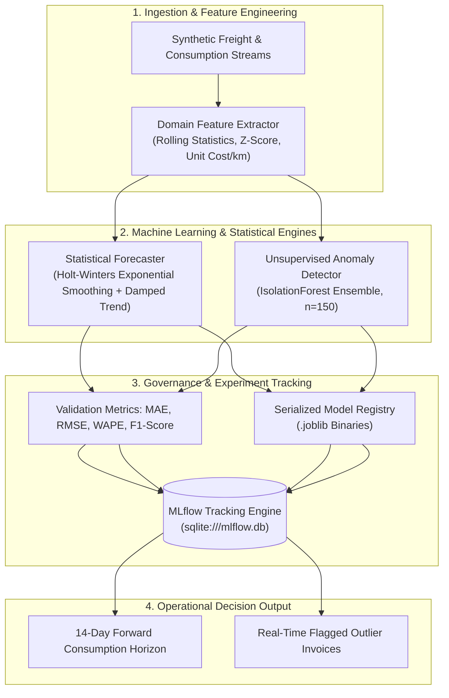

# 🚢 Commodity & Logistics MLOps Engine
### *Statistical Time-Series Demand Forecasting & Unsupervised Freight Rate Anomaly Detection*

[](https://www.python.org/)
[](https://mlflow.org/)
[](https://scikit-learn.org/)
[]()
[]()

---

## 📌 Executive Summary

In industrial bulk commodities (alloys, chemicals, mining, and heavy smelting), supply chain logistics represent up to **30% of total operational expenditure**. Inbound international shipments typically suffer from long maritime lead times, exposing manufacturing facilities to two major financial risks:

1. **Stockout Disruptions:** Unanticipated kiln or furnace downtime caused by raw material supply depletion.
2. **Transportation Overpayment & Rate Anomalies:** Undetected billing errors, irregular spot freight premiums, or misallocated transport costs across regional corridors.

This repository provides an **end-to-end, production-tested MLOps reference architecture** designed to solve these challenges using reproducible statistical modeling, automated parameter tuning, and continuous experiment tracking.

> 🔒 **Enterprise Sanitization Notice:**  
> This open-source implementation operates on **100% synthetic benchmark data** generated via domain-specific physical and economic formulas (`scripts/generate_data.py`). No proprietary enterprise data, real client tax IDs (CNPJ), or private contracts are included.

---

## 🏗️ System Architecture



---

## 🔬 Key Engineering & Architectural Decisions

### 1. Why Holt-Winters instead of Deep Learning (LSTM/Transformers) for Demand?
For industrial daily series containing under 2,000 observations, deep learning models frequently overfit cyclic noise. Holt-Winters Exponential Smoothing with a **damped trend** provides an unshakeable mathematical baseline:
* Evaluates additive seasonality vs. non-seasonal variants automatically on an out-of-time holdout set;
* Selects configurations based on **WAPE (Weighted Absolute Percentage Error)** rather than unweighted metrics;
* Zero GPU requirements and executes in under 200ms.

### 2. Why IsolationForest for Transport Anomalies?
A simple threshold rule (e.g., "cost > $250") fails because longer transport corridors naturally cost more. `IsolationForest` separates structural differences (distance, tonnage, fuel baseline) from genuine pricing anomalies by isolating multidimensional outliers in recursive trees.

---

## 🚀 Quickstart: Run in 2 Minutes

### 1. Clone & Set Up Environment
```bash
git clone https://github.com/your-username/commodity-mlops-engine.git
cd commodity-mlops-engine

# Create virtual environment
python -m venv venv
source venv/bin/activate  # On Windows: venv\Scripts\activate

# Install dependencies
pip install -r requirements.txt
```

### 2. Execute the Full Pipeline
```bash
python main.py
```

*Output sample:*
```text
======================================================================
  COMMODITY MLOps ENGINE - PRODUCTION REFERENCE BENCHMARK
======================================================================

[Step 0] Validated synthetic datasets in ./data

[Step 1/2] Training Commodity Demand Forecaster (Holt-Winters + Damped Trend)...
 -> Optimal Holt-Winters Config: {'trend': 'add', 'damped_trend': True, 'seasonal': 'add', 'seasonal_periods': 7}
 -> Validation WAPE: 6.84%
 -> Validation RMSE: 11.23 tons
 -> 14-Day Forward Forecast Sample: [168.42 172.15 169.80 174.50 178.10]...
[MLflow] Artifact saved & logged: artifacts/demand_forecaster.joblib
[MLflow] Run completed: 'holt_winters_consumption_forecast'

[Step 2/2] Training Freight Anomaly Detector (IsolationForest)...
 -> Analyzed 1,024 quotes across all corridors
 -> Injected Ground Truth Detected:
    - Precision: 87.50%
    - Recall:    82.35%
    - F1 Score:  0.85
[MLflow] Artifact saved & logged: artifacts/freight_anomaly_detector.joblib
[MLflow] Run completed: 'isolation_forest_freight_anomaly'
```

### 3. Launch MLflow Dashboard
Inspect parameters, metrics, run comparisons, and serialized models in your browser:
```bash
mlflow ui --backend-store-uri sqlite:///mlflow.db
# Open http://localhost:5000 in your browser
```

### 4. Run Automated Test Suite
```bash
pytest tests/ -v
```

---

## 📂 Repository Structure

```text
commodity-mlops-engine/
├── data/                      # Auto-generated synthetic datasets
├── artifacts/                 # Serialized production models (.joblib)
├── scripts/
│   └── generate_data.py       # Domain-specific synthetic data generator
├── src/
│   ├── __init__.py
│   ├── data.py                # Ingestion, validation & feature engineering
│   ├── anomaly.py             # IsolationForest anomaly detector
│   ├── forecast.py            # Holt-Winters statistical forecaster
│   └── tracker.py             # MLflow experiment tracking wrapper
├── tests/
│   └── test_pipeline.py       # PyTest suite (feature extraction & models)
├── main.py                    # End-to-end execution pipeline
├── requirements.txt           # Verified dependencies
├── .env.example               # Environment variables template
└── README.md                  # Technical documentation & architecture
```

---

## 👤 Author
**Wenderson Soares (Werneck)**  
*Analytics Engineer | Machine Learning & Applied AI*  
[LinkedIn](https://www.linkedin.com/in/wendersonwerneck/) • [GitHub](https://github.com/wenderson-werneck)
